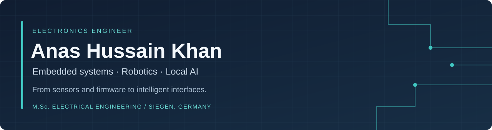

  

  <a href="https://app.notion.com/p/Anas-Hussain-Khan-2bbcc46b30a080e39611d4e9058fe91e?source=copy_link"><strong>Explore my portfolio ↗</strong></a>
  &nbsp; · &nbsp;
  <a href="https://www.linkedin.com/in/anas-hussain-khan-k1/">Connect on LinkedIn</a>
  &nbsp; · &nbsp;
  <a href="#selected-projects">Explore the projects ↓</a>

I build systems that connect **physical hardware with useful software**: STM32 sensor firmware, ESP32 audio interfaces, Raspberry Pi voice assistants, and robotic mechanisms. I enjoy the complete engineering process—from wiring and peripheral configuration to debugging, visualization, and documentation.

Currently pursuing an **M.Sc. in Electrical Engineering — Electronics Design and Technology at the University of Siegen**, while guiding student electronics and embedded projects as a **Student Lab Supervisor at eLab Siegen**.

**B.E. Industrial Electronics · IIEE / NED University · CGPA 3.682/4.00 — Gold Medalist · Ranked 1st of 52**

## Selected projects

### 01 · STM32 attitude estimation & 3D telemetry
**[AeroPulse / AeroScope →](https://github.com/AnasHussaink/AeroPulse-STM32-Attitude-Estimation-3D-Telemetry)**  
A complete bench system connecting an MPU6500 IMU, STM32 firmware, an I2C LCD, and a Python 3D ground station. Complementary filtering estimates roll/pitch; UART carries telemetry to the desktop, with CSV logging and optional ThingsBoard cloud monitoring.

`Embedded C` `STM32 HAL` `SPI / I2C / UART` `PySide6 / QML` `MQTT / TLS`  
**Engineering focus:** sensor calibration, firmware-to-GUI integration, and host-side PID/motor-mixing simulation.

### 02 · AURA — local AI desk companion
**[Explore AURA →](https://github.com/AnasHussaink/Autonomous-Ubiquitous-Robotic-Assistant-on-the-Edge)**  
A Raspberry Pi 4 voice-and-display prototype combining physical I2S audio, local speech recognition, local language-model inference, speech synthesis, and an expressive touchscreen interface.

`Python` `Raspberry Pi` `ALSA / I2S` `FastAPI` `Ollama` `Faster-Whisper` `Piper`  
**Engineering focus:** integrating Linux audio, AI services, interface states, and automatic startup on constrained hardware.

### 03 · VoiceCore — ESP32-S3 voice assistant
**[Explore VoiceCore →](https://github.com/AnasHussaink/Voice_Core_ESP32_Edge_AI_Voice-Assistant)**  
Embedded audio capture and playback with an INMP441 microphone, MAX98357A amplifier, PSRAM buffering, WAV handling, and a capture/network/playback state machine. Speech and language processing use cloud services.

`C++` `ESP32-S3` `Arduino` `I2S / DMA` `PSRAM` `HTTP`  
**Engineering focus:** resource-aware audio pipelines and hardware–software troubleshooting.

### 04 · Intelligent robotic color sorting
**[Explore the EV3 robot →](https://github.com/AnasHussaink/Intelligent-Color-Sorting-Robot-Using-LEGO-EV3)**  
An articulated manipulator and conveyor that classify colored objects and execute pick-and-place sequences. Combines touch-sensor homing, RGB calibration, geometric inverse kinematics, and encoder-based positioning.

`MicroPython` `Pybricks` `LEGO EV3` `Kinematics` `Motor control`  
**Engineering focus:** coordinating sensing, mechanism geometry, and repeatable motion.

### 05 · EEG acquisition & classroom research prototype
**[Explore the EEG project →](https://github.com/AnasHussaink/Enhancing-Student-Performance-Through-an-EEG-AI-Classroom-Device)**  
A **team final-year project** spanning a TGAM wearable, Bluetooth serial acquisition, Python dashboards, logging, and enclosure development. Separate CNN–BiLSTM experiments explore public EEG data; they are distinct from the wearable's device-generated attention scores.

`Python` `PySerial` `Tkinter / Matplotlib` `MATLAB` `TensorFlow / Keras`  
**Engineering focus:** hardware integration, binary protocols, visualization, and transparent documentation of research limitations.

### 06 · Semiconductor characterization
**[Explore the BC141 laboratory work →](https://github.com/AnasHussaink/BC141-BJT-Characterization-in-a-Cleanroom-Laboratory)**  
Hands-on BJT measurement using an MPI probe station, optical microscope alignment, and a Keysight B1500A Semiconductor Device Analyzer with EasyEXPERT.

`Semiconductor measurement` `Probe alignment` `Electrical characterization`  
**Engineering focus:** measurement setup, device contacting, and laboratory documentation.

**Also explore:** [ESP32-S3 I2S audio lab](https://github.com/AnasHussaink/ESP32-S3-I2S-Audio-System-Microphone-Speaker-Loopback) · [Siegen student jobs guide](https://github.com/AnasHussaink/Siegen_Jobs)

## Engineering toolkit

| Area | Tools and practical experience |
| :--- | :--- |
| **Embedded firmware** | C / C++, STM32 HAL, STM32CubeIDE / CubeMX, ESP32 / ESP32-S3, Arduino, MicroPython |
| **Interfaces & sensing** | SPI, I2C, UART, I2S, GPIO, IMU integration, calibration, DMA and audio buffering |
| **Python & interfaces** | Python, PySide6, Qt Quick 3D / QML, PySerial, FastAPI, NumPy, pandas, Matplotlib |
| **Robotics & control** | Homing, inverse kinematics, encoder feedback, PID concepts, motor-mixing simulation |
| **Industrial automation** | Siemens S7-1200, WinCC, Wonderware InTouch, Honeywell Experion PKS / HC-900, PLC / DCS / SCADA |
| **Digital & PCB design** | Verilog, Vivado, Artix-7, FSMs, RTL simulation, XDC constraints; Altium Designer, KiCad, Proteus |
| **AI & signal work** | Local inference integration, speech interfaces, OpenCV, EEG visualization, MATLAB / Simulink |

<strong>More hardware work and current technical interests</strong>

- **FPGA:** Verilog traffic-light FSM and parameterized LED blinker, including behavioral simulation and validation on a Digilent Arty Artix-7 board.
- **Electronics:** PCB design, circuit debugging, analog circuits, and sensor integration.
- **Interests:** embedded intelligence, audio/voice interfaces, practical robotics, and dependable hardware–software integration.

Additional project context is available in my [portfolio](https://app.notion.com/p/Anas-Hussain-Khan-2bbcc46b30a080e39611d4e9058fe91e?source=copy_link).

## Industry, teaching & community

- **eLab Siegen · Student Lab Supervisor · February 2026–present:** guide electronics and embedded projects, support Arduino / ESP32 / STM32 workshops, and help students troubleshoot circuits and firmware.
- **The Automators · Trainee Control System Engineer · April–September 2025:** Honeywell DCS / HC-900 communications, SCADA troubleshooting, Siemens HMI and PLC support.
- **Indus Motor Company · Trainee Engineer, Automation & Robotics · October 2024–April 2025:** Kawasaki robot maintenance, industrial sensing, PLC monitoring, and process troubleshooting.
- **MindTrack Innovators · Founder & Director · 2023–2024:** EEG-focused educational prototype development and startup leadership.
- **IEEE IIEE Karachi · Chairperson · 2023–2024:** technical workshops, seminars, and student engineering activities.
- **Erasmus+ Youth Exchange · Germany · January 2026:** digital responsibility and intercultural collaboration.

---

### Let's build something useful
Interested in exchanging ideas and collaborating on **embedded firmware, sensor systems, robotics, or practical AI interfaces**.

**[Portfolio](https://app.notion.com/p/Anas-Hussain-Khan-2bbcc46b30a080e39611d4e9058fe91e?source=copy_link) · [LinkedIn](https://www.linkedin.com/in/anas-hussain-khan-k1/)**  
Siegen, Germany · English C1 · German A2 · Urdu native
